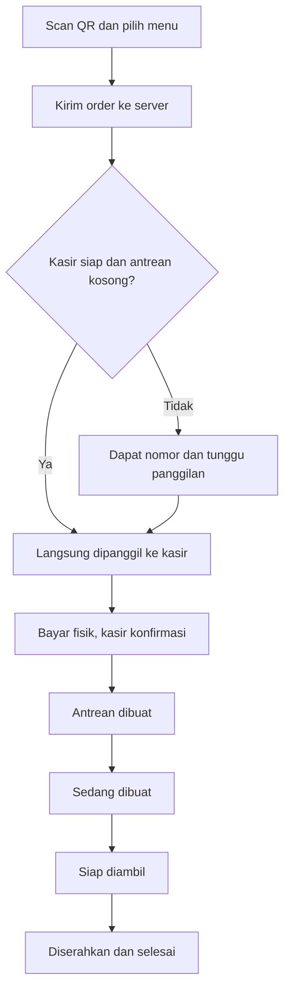

# PROMPT AGENT — TOODAY QR ORDER, KASIR & LAYAR ANTREAN

> Cara pakai: letakkan file ini di root repository web Tooday. Minta agent: “Baca PROMPT_AGENT_TOODAY_QR_ORDER_KASIR.md, audit project yang ada, kemudian implementasikan sampai alur pengunjung–kasir–layar antrean berjalan dan teruji.”
>
> Dokumen ini adalah brief implementasi fitur pada website yang sudah selesai. Acuan utama: https://toodaycoffe.netlify.app/ . Bukan instruksi membuat ulang website dari nol.
>
> Referensi tampilan diamati pada 13 Oktober 2026. Semua keputusan operasional yang diberi label **default V1** adalah rancangan yang dapat diubah melalui konfigurasi, bukan fakta tentang operasional outlet.

## 1. Misi dan hasil akhir

Bertindaklah sebagai senior full-stack engineer, product designer, dan UX writer. Kembangkan website Tooday menjadi sistem **scan QR → pilih menu → kirim pesanan → bayar di kasir → tunggu pesanan**.

Pengunjung datang ke outlet, memindai QR dengan kamera HP, membuka website Tooday, memilih menu, mengatur jumlah, dan mengirim pesanan. Pesanan tersimpan di database bersama serta langsung terlihat pada web kasir. Pembayaran berlangsung secara fisik di kasir; aplikasi hanya mencatat konfirmasi pembayaran oleh staf.

Hasil akhir harus benar-benar tersambung antarperangkat. Dua tab yang berbagi localStorage bukan pengganti integrasi backend.

Prioritas: ketepatan pesanan dan antrean, kejelasan instruksi, keamanan akses kasir, pengalaman mobile, kemudian detail visual dan animasi.

## 2. Konteks website yang wajib diteruskan

Pengamatan website saat brief disusun:

- Header berisi logo PNG, Menu, Cerita, Saran menikmati, Instagram, tombol **Pilihanku**, dan **Jelajahi Menu**.
- Hero bertuliskan **“Make every day, tooday!”** dengan cream background, headline olive yang bulat, produk kopi–matcha–ButterTteok, maskot cowok-cewek, checkerboard, dan doodle merah.
- Font headline yang teramati: **Fredoka**. Font isi: **DM Sans**.
- Menu memiliki 14 item dalam Coffee, Matcha, Non-Coffee, dan Cemal-cemil.
- Ada detail produk, penyimpanan ke “Pilihanku”, rekomendasi pairing, cerita, serta galeri.
- Dialog “Pilihanku” saat kosong berbunyi bahwa belum ada menu yang disimpan. Kembangkan titik interaksi ini menjadi keranjang dengan jumlah, subtotal, dan tombol kirim pesanan.
- Pairing saat ini adalah saran menikmati dua produk yang dihargai masing-masing, bukan paket diskon.
- URL gambar pada halaman menggunakan jalur `/_next/image`. Ini merupakan indikasi penggunaan Next.js; versi framework, router, dan struktur repository tetap wajib diperiksa.

**Website/repository terkini menjadi acuan desain dan data.** Jangan menimpa hasil finalnya dengan art direction dari prompt lama. Pertahankan homepage dan cerita brand; tambahkan jalur pemesanan yang lebih singkat.

Audit `package.json`, lockfile, routing, komponen menu/detail/Pilihanku, sumber data produk, token CSS, font, aset, konfigurasi Netlify, serta backend jika sudah ada. Catat reuse dan perubahan yang diperlukan sebelum mengedit.

## 3. Ruang lingkup V1

### Wajib

1. Entry QR untuk satu outlet.
2. Menu mobile, kategori, detail, pilihan varian yang memang tersedia, jumlah, catatan, keranjang.
3. Ringkasan dan submit pesanan ke server.
4. Tiket pesanan dan status milik pengunjung.
5. Dashboard kasir dengan login staf.
6. Antrean pembayaran dan pemanggilan ke kasir.
7. Konfirmasi pembayaran manual oleh kasir.
8. Status pembuatan sampai pesanan diambil.
9. Layar antrean publik yang hanya menampilkan informasi minimum.
10. Sinkronisasi antarperangkat, fallback koneksi, validasi, dan audit perubahan penting.
11. Tombol buka/tutup penerimaan order dan pengaturan ketersediaan menu.
12. QR siap cetak setelah URL tujuan final terkonfigurasi.

### Di luar V1

Payment gateway, checkout kartu, pembayaran online, bukti transfer yang diunggah pelanggan, QR pembayaran, delivery, loyalty, split bill, split payment, akuntansi lengkap, stok bahan baku, integrasi printer khusus, dan POS pihak ketiga.

“Web kasir” di brief ini berarti dashboard staf baru yang berbagi backend dengan web pengunjung. Bila repository ternyata sudah terhubung ke POS lain, dokumentasikan integrasi yang tersedia; jangan mengarang API milik vendor.

Tidak perlu aplikasi mobile native atau login pelanggan dengan email/nomor HP.

## 4. Konsep pengalaman: “Pilih dulu. Bayar di kasir. Nikmati tooday.”

Tiga permukaan, satu sumber data:

| Permukaan | Pengguna | Tugas utama |
|---|---|---|
| Web pengunjung | Pengunjung di HP | Memilih, mengirim, melihat kode dan instruksi berikutnya |
| Web kasir | Staf yang login | Melihat order, memanggil, menerima pembayaran, mengubah status |
| Layar antrean | Pengunjung di outlet | Melihat nomor yang dipanggil, sedang dibuat, dan siap diambil |

Gunakan satu project dan backend bersama sebagai default. Web kasir dapat dibuka di laptop/tablet lain melalui route khusus. Subdomain terpisah belum diperlukan.

**Dua antrean harus dibedakan secara jelas:**

- **Antrean bayar:** pesanan belum dibayar, menunggu giliran ke kasir.
- **Antrean dibuat:** pesanan sudah dibayar, menunggu/menjalani pembuatan.

Nomor pesanan tetap sama sepanjang kedua tahap tersebut. Jangan membuat nomor baru setelah pembayaran.

### Prinsip operasional default V1

- Satu outlet dan satu loket pembayaran aktif.
- Setiap order yang berhasil tersimpan mendapat kode tetap, contoh `T-042`.
- Nomor menunjukkan identitas pesanan, bukan “jumlah orang di depan”.
- Saat kasir siap dan antrean bayar kosong, order pertama otomatis berstatus dipanggil: pengunjung langsung ke kasir.
- Saat masih ada order menunggu/dipanggil atau kasir dijeda, order baru masuk antrean bayar.
- Pesanan baru boleh masuk antrean dibuat setelah kasir mengonfirmasi uang/pembayaran fisik telah diterima.
- Pembayaran fisik bisa mengikuti fasilitas outlet. Sistem ini tidak memindahkan uang dan tidak memverifikasi pembayaran bank.
- Produksi yang ramai tidak otomatis berarti antrean bayar ramai; hitung kedua tahap secara terpisah.
- Pelanggan yang telah membayar tidak diminta membayar lagi.

## 5. Alur pengunjung secara lengkap

### A. Scan dan masuk

QR mengarah ke route menu cepat, contoh konfigurasi:

```text
/order?outlet=tooday-main&source=qr
/order?outlet=tooday-main&table=M03&source=qr
```

Itu contoh struktur URL, bukan endpoint yang sudah tersedia. Bangun absolute URL dari domain final yang dikonfigurasi.

QR outlet umum wajib; QR per meja opsional jika outlet memang menggunakan meja bernomor. Parameter outlet/meja harus dicocokkan dengan data aktif di server. QR adalah tautan masuk, bukan bukti kehadiran fisik atau hak akses staf.

Halaman QR langsung menampilkan sapaan pendek dan menu. Jangan memaksa pengunjung menonton preloader, membuka hero panjang, atau melewati storytelling sebelum bisa memilih.

Contoh sapaan:

> “Halo, sudah siap pilih yang enak?”
>
> “Pilih dari sini. Pembayarannya nanti di kasir, ya.”

Tampilkan konteks outlet/meja jika valid, status penerimaan order, dan akses ke pesanan aktif milik sesi ini.

### B. Pilih menu

- Reuse kartu dan detail produk existing.
- Tambahkan CTA **“Tambah”** atau **“Masukkan ke Pilihanku”**.
- Jumlah dapat diubah; tampilkan harga satuan dan subtotal.
- Varian gula/es/ukuran hanya muncul bila benar-benar disediakan data menu. Jangan menciptakan opsi baru.
- Catatan opsional maksimal 200 karakter. Tulis “Permintaan khusus akan dikonfirmasi kasir.”
- Menu habis tetap dapat dilihat dengan label **“Lagi habis”** dan CTA nonaktif.
- Harga belum terverifikasi/kosong tidak boleh diperlakukan sebagai Rp0.
- Untuk pairing, tambahkan dua SKU terpisah; total merupakan penjumlahan harga normal.
- Foto kategori tidak boleh dijadikan bukti bahan, varian, atau porsi.

### C. Keranjang “Pilihanku”

Desktop menggunakan drawer existing; mobile dapat menjadi bottom sheet tinggi atau halaman penuh. Isinya foto kecil, nama, varian, catatan, stepper jumlah, hapus, serta total.

Sticky bar mobile:

> “3 item · Rp75.000” — **“Lihat Pilihanku”**

Perbedaan fungsi wajib jelas: **“Tambah” hanya mengubah keranjang; belum mengirim pesanan ke kasir.**

Default V1 menyediakan pilihan **Dine-in / Takeaway**, dengan nilai default yang terlihat dan bisa diubah. Meja hanya ditampilkan untuk dine-in yang memakai QR meja. Nama panggilan opsional, maksimal 30 karakter; telepon/email tidak diperlukan.

Sebelum submit, tampilkan ringkasan dan:

> **“Pembayaran dilakukan di kasir.”**
>
> “Cek pilihanmu dulu. Pesanan akan mulai dibuat setelah pembayaran dikonfirmasi.”

CTA utama: **“Kirim pesanan”**. Total menggunakan format rupiah penuh, misalnya Rp55.000. Pajak/biaya layanan hanya ditambahkan bila konfigurasi resmi outlet sudah diberikan, dan harus terlihat sebelum submit. Default tidak menambahkan biaya baru.

Saat submit, tombol menampilkan **“Mengirim pesanan…”** dan mencegah tap berulang. Kosongkan keranjang hanya setelah server mengembalikan order yang berhasil disimpan.

### D. Tiket sukses: kasir kosong

Setelah transaksi server berhasil dan slot kasir diberikan pada order ini, tampilkan halaman tiket permanen, bukan toast yang hilang:

> **“Pesananmu sudah masuk!”**
>
> **“Lakukan pembayaran di kasir.”**
>
> “Kasir siap melayani. Yuk, langsung ke kasir dan tunjukkan kode ini.”
>
> **T-042**
>
> “Belum dibayar · Total Rp55.000”

Kode tetap disediakan meskipun tidak perlu menunggu antrean. Tampilkan ringkasan pesanan dan tombol **“Lihat rincian”**.

### E. Tiket sukses: kasir sedang ramai

> **“Pesananmu sudah masuk!”**
>
> **“Lakukan pembayaran di kasir.”**
>
> “Nomor antrean bayarmu”
>
> **T-043**
>
> “Ada 2 pesanan di depanmu. Tunggu nomormu dipanggil di layar.”
>
> “Belum dibayar · Total Rp55.000”

Jumlah di depan harus hasil server dan diperbarui; jangan memakai nomor pesanan dikurangi satu. Jangan menampilkan perkiraan menit tanpa data yang mendukung.

Ketika dipanggil:

> **“Giliranmu, T-043!”**
>
> “Yuk, ke kasir untuk melakukan pembayaran.”

Jika kasir sedang dijeda dan tidak ada order di depan:

> “Kasir sedang melayani keperluan lain. Tunggu nomormu dipanggil, ya.”

Jangan menampilkan “langsung ke kasir” hanya karena hitungan antrean nol.

### F. Setelah pembayaran

Pembaruan harus mengikuti status server:

| Status | Judul pelanggan | Penjelasan |
|---|---|---|
| Sudah dibayar, menunggu dibuat | “Pembayaran sudah diterima.” | “Pesananmu masuk antrean dibuat.” |
| Sedang dibuat | “Lagi disiapin buat kamu.” | “Pantau kode T-043 di layar pesanan, ya.” |
| Siap diambil | “T-043, pesananmu siap!” | “Silakan ambil di area pengambilan.” |
| Selesai | “Selamat menikmati tooday!” | “Terima kasih sudah mampir.” |

Default pengambilan di counter. Jangan menjanjikan antar meja hanya karena ada nomor meja.

Pertahankan halaman status setelah refresh/reconnect pada sesi yang sama. Akses kembali ke detail harus terotorisasi; kode T-043 sendiri bukan kata sandi.

## 6. Nomor, antrean, dan aturan serentak

### Penomoran

Gunakan integer urut dari database per outlet, tampilkan minimal tiga digit: T-001, T-042, T-999, T-1000. **Default V1 tidak mereset nomor setiap hari**, sehingga tidak ada tabrakan order aktif lintas tengah malam. Simpan waktu dan tanggal bisnis tersendiri untuk laporan.

Nomor dialokasikan dalam transaksi dengan counter row yang dikunci atau mekanisme database atomik. Tambahkan constraint unik pada outlet dan nomor. Jangan menggunakan panjang array, localStorage, waktu browser, atau `MAX(number) + 1` tanpa locking.

Gunakan UUID internal untuk relasi data. Kode publik hanya untuk komunikasi di outlet.

### Algoritma antrean bayar

Semua keputusan berikut berjalan di database/server dalam transaksi:

1. Validasi order dan identitas sesi.
2. Periksa idempotency key; permintaan ulang yang sama mengembalikan hasil order yang sama.
3. Kunci state loket/outlet dan counter.
4. Simpan order, item snapshot, nomor, timestamp, serta audit event.
5. Jika loket siap, tidak ada order CALLED, dan tidak ada WAITING_PAYMENT yang lebih dahulu: tetapkan order baru menjadi CALLED.
6. Jika syarat tersebut tidak terpenuhi: tetapkan WAITING_PAYMENT.
7. Simpan perubahan feed layar antrean dan hasil respons, lalu commit.

Constraint atau aturan transaksi menjamin **maksimal satu CALLED per outlet** pada default satu loket.

Urutan tunggu: `queue_entered_at`, lalu ID sebagai tie-breaker. Semua order aktif ikut diperhitungkan, termasuk order dari tanggal sebelumnya.

Saat kasir mengonfirmasi pembayaran, order tersebut keluar dari antrean bayar dan masuk QUEUED. Default **auto-call-next aktif**: server memilih order WAITING_PAYMENT terlama, selama loket siap. Kasir dapat menjeda pemanggilan dan melanjutkannya.

Antrean produksi diurutkan berdasarkan waktu pembayaran diterima, lalu ID sebagai tie-breaker. Nomor order yang lebih kecil tidak otomatis mendahului pelanggan yang sudah membayar lebih dahulu. Saat loket dilanjutkan, pemilihan satu order berikutnya juga harus atomik.

Pisahkan pengaturan **“Terima order baru”** dari **“Jeda panggilan kasir”**. Keduanya bukan deteksi apakah tab kasir sedang terbuka.

### Tidak hadir dan pembatalan

- Kasir dapat menekan **“Lewati sementara”** untuk CALLED → DEFERRED dengan alasan; slot kasir dilepas dan order berikutnya dipanggil.
- Pelanggan DEFERRED melihat “Nomormu terlewat. Silakan beri tahu kasir saat sudah siap.”
- Staf dapat mengembalikan DEFERRED ke ekor antrean; nomor tetap, `queue_entered_at` diperbarui dan dicatat.
- Pelanggan hanya dapat membatalkan order miliknya yang UNPAID serta WAITING_PAYMENT/DEFERRED. Saat CALLED, arahkan ke kasir.
- Kasir dapat membatalkan order belum dibayar dengan alasan.
- V1 tidak menyediakan tombol pembatalan atau perubahan nominal setelah pembayaran. Koreksi transaksi berbayar ditangani pengelola melalui prosedur manual yang terdokumentasi; jangan mengubahnya diam-diam menjadi unpaid.
- Expiry unpaid dapat dikonfigurasi; default 120 menit untuk WAITING_PAYMENT/DEFERRED. CALLED tidak kedaluwarsa otomatis saat kasir sedang menerima pembayaran.
- Scheduler dan endpoint perubahan status harus memeriksa waktu serta state terkini dalam transaksi. Lomba antara expiry, cancel, dan payment hanya boleh menghasilkan satu hasil sah.
- Expired/cancelled tidak menghapus riwayat, menggunakan ulang nomor, atau masuk antrean produksi.

## 7. Model status yang tegas

Pisahkan `payment_status` dari `order_status`, tetapi validasi kombinasinya di server.

| order_status | payment_status | Arti | Aksi berikut yang sah |
|---|---|---|---|
| WAITING_PAYMENT | UNPAID | Menunggu giliran bayar | CALLED, CANCELLED, EXPIRED |
| CALLED | UNPAID | Diminta datang ke kasir | QUEUED melalui konfirmasi bayar, DEFERRED, CANCELLED |
| DEFERRED | UNPAID | Panggilan dilewati sementara | WAITING_PAYMENT, CANCELLED, EXPIRED |
| QUEUED | PAID | Menunggu pembuatan | PREPARING |
| PREPARING | PAID | Sedang dibuat | READY |
| READY | PAID | Siap diambil | COMPLETED |
| COMPLETED | PAID | Sudah diserahkan | Terminal |
| CANCELLED | UNPAID | Dibatalkan sebelum bayar | Terminal |
| EXPIRED | UNPAID | Tidak dilanjutkan sebelum batas waktu | Terminal |

PAID berarti **kasir telah mencatat pembayaran fisik diterima**, bukan hasil pemeriksaan bank otomatis.

Perubahan CALLED → QUEUED dan UNPAID → PAID merupakan satu operasi atomik, beserta pencatatan staf, waktu, nominal, dan audit event. Generic update status tidak boleh melewati aturan ini.

Pengunjung tidak memiliki aksi “Sudah bayar”. Tidak ada status sukses bayar akibat redirect, timer, atau klik pelanggan.



## 8. Dashboard kasir — “Tooday Counter”

Route default `/kasir`, login staf di `/kasir/login`. Optimalkan untuk tablet landscape dan laptop; tetap dapat dipakai pada HP.

### Struktur layar

- Header ringkas: logo PNG, “Tooday Counter”, nama outlet, identitas staf, jam, indikator koneksi.
- Ringkasan: Belum dibayar, Menunggu dibuat, Sedang dibuat, Siap diambil.
- Navigasi tab status dengan angka aktual, pencarian kode, filter rentang tanggal untuk riwayat.
- Panel kiri/utama: daftar tiket yang diurutkan sesuai tahap.
- Panel detail kanan: kode besar, waktu masuk, dine-in/takeaway, meja jika ada, item, jumlah, varian, catatan, total, status, aksi.
- Tombol pengaturan outlet untuk ketersediaan menu dan penerimaan order.
- Riwayat tindakan relevan pada detail untuk menelusuri siapa mengubah apa.

Status belum dibayar harus terlihat tegas dengan label teks **“BELUM DIBAYAR”**. Jangan menaruhnya di daftar produksi.

### Aksi kasir

1. Panggil berikutnya / panggil ulang.
2. Lewati sementara / kembalikan ke antrean.
3. Buka rincian order.
4. **“Konfirmasi pembayaran diterima”**.
5. Mulai dibuat.
6. Siap diambil / panggil ulang pengambilan.
7. Selesaikan setelah diserahkan.
8. Batalkan unpaid dengan alasan.
9. Tandai produk tersedia/habis.
10. Jeda/lanjutkan pemanggilan serta buka/tutup order baru.

Modal pembayaran menampilkan kode, item, total, dan pertanyaan:

> “Pembayaran Rp55.000 untuk T-043 sudah diterima di kasir?”

Aksi utama: **“Ya, pembayaran diterima”**. Tombol hanya aktif pada state sah. Rekam nominal persis dari order; jangan menerima harga kiriman browser.

Metode pembayaran boleh menjadi pilihan konfigurasi untuk pencatatan internal, tanpa koneksi gateway. Jangan otomatis menyediakan label QRIS atau kartu bila outlet belum mengonfirmasi metode itu.

Pembaruan dari staf lain membuat panel menyegarkan state. Gunakan version check agar dua staf tidak mengonfirmasi, memanggil, atau menyelesaikan order yang sama dua kali.

Notifikasi order baru berupa badge/banner. Audio opsional aktif setelah staf menekan **“Aktifkan suara”**, dengan mute dan deduplikasi. Jangan menjanjikan push notification pada HP yang menutup website.

**Aktifkan tombol payment manual hanya jika server dapat dihubungi.** Jika pembayaran fisik sudah diterima tetapi update gagal, tampilkan langkah rekonsiliasi; jangan menginstruksikan pelanggan membayar ulang.

## 9. Layar antrean — “Your tooday is on the way”

Route default `/antrean`, read-only, nyaman di TV 16:9. Bisa dibuka langsung sebagai layar publik karena payload-nya memang disanitasi.

Tiga blok jelas:

| Blok | Yang ditampilkan |
|---|---|
| Silakan ke kasir | Nomor CALLED besar, nomor WAITING_PAYMENT berikutnya dalam urutan |
| Sedang disiapkan | Kode QUEUED dan PREPARING, dengan label tahap yang tepat |
| Siap diambil | Kode READY, paling kontras |

Jangan menampilkan nama pelanggan, nomor HP, isi catatan, detail item, harga, identitas staf, atau token akses.

Jika kosong:

> “Belum ada antrean. Pilih yang enak untuk tooday!”

Jika terputus:

> “Koneksi terputus. Status mungkin belum terbaru.”

Jangan menghapus semua daftar lalu menampilkan “tidak ada antrean” saat fetch gagal. Pertahankan snapshot terakhir dengan penanda stale.

Nomor dipanggil dapat pulse satu kali. Audio/chime atau pembacaan nomor opsional setelah operator mengaktifkannya. Panggil ulang menggunakan event ID baru yang sah; reconnect tidak memutar ulang semua panggilan lama.

Sediakan fullscreen melalui tombol operator, daftar yang muat pada layar, dan pagination/rotasi terukur bila banyak order. READY jangan hilang sebelum diselesaikan kasir.

## 10. Art direction: tetap Tooday, dengan fungsi yang jelas

### Token brand

Reuse token repository. Nilai acuan paket aset yang cocok dengan tampilan saat ini:

```css
--tooday-cream: #FCF9DA;
--tooday-olive: #3C4A26;
--tooday-red: #BC1823;
--tooday-ink: #202817;
```

Cream dominan untuk halaman/menu/tiket. Olive untuk teks, outline, panel struktural. Merah untuk CTA dan penekanan singkat. Pertahankan Fredoka pada headline dan DM Sans untuk formulir, harga, tabel, serta informasi padat. Pakai angka tabular pada total, waktu, dan nomor antrean.

Jangan mengganti palet, menggambar ulang logo, atau merombak homepage. Gunakan font yang sudah dimuat; jangan menambah font dekoratif lain.

### Visual khas per permukaan

**Pengunjung:** mini hero sapaan dengan kepala maskot; kategori berbentuk pill; foto produk besar tetapi ringan; keranjang berbentuk lembar catatan; tiket sukses seperti struk kafe dengan tepi bergerigi dekoratif, garis perforasi, nomor besar, stempel status, dan checkerboard tipis.

**Kasir:** cream canvas, panel olive, tiket dengan outline lembut, satu maskot kecil pada header/empty state. Area tindakan tetap rapi, kontras, dan stabil saat order baru masuk. Jangan memindahkan tombol yang sedang akan ditekan akibat sorting otomatis.

**Layar antrean:** layout papan kafe, headline pendek, nomor sangat besar, checker strip tepi, maskot menunjuk ke nomor yang dipanggil. Informasi harus mudah dibaca dari jarak beberapa meter.

Tiket boleh memiliki dekorasi kertas miring maksimal sekitar 1–2 derajat di luar area teks; konten utama dan tombol tetap tegak. Dekorasi tidak menutupi harga, nomor, atau status.

### Aset yang dapat dipakai kembali

Periksa keberadaan file sebelum mereferensikannya; gunakan aset setara yang sudah ada jika struktur repository berbeda.

| Peran | Path kandidat dari paket sebelumnya |
|---|---|
| Logo PNG yang sudah digunakan | `/assets/tooday/brand/tooday-logo-restored.png` |
| Maskot cowok kecil | `/assets/tooday/addons/characters/mascot-boy-head-512.png` |
| Maskot cewek kecil | `/assets/tooday/addons/characters/mascot-girl-head-512.png` |
| Maskot mengintip tiket | `/assets/tooday/addons/characters/mascot-boy-peeking-512.png` |
| Maskot membawa minuman | `/assets/tooday/addons/characters/mascot-boy-with-cup-512.png` |
| Visual pairing tambahan | `/assets/tooday/addons/compositions/pairing-coffee-matcha-buttertteok-512.png` |
| Kursor karakter | `/assets/tooday/cursor/tooday-pointing-48.png` |
| Foto menu | `/assets/tooday/products/` |
| Ornamen checker | `/assets/tooday/decor/` |

Logo tetap bersumber dari PNG. File “restored” adalah aset yang telah dipakai, bukan alasan untuk menghasilkan logo baru. Bila tersedia master resmi yang lebih baru, utamakan master tersebut.

Maskot menjadi pemandu: cowok menyambut/pilih menu, cewek menemani antrean, karakter menunjuk memberi arah ke kasir. Gunakan ilustrasi yang ada; jangan mengarang karakter pengganti jika file belum tersedia.

### Motion dan aksesibilitas

- Tambah item: feedback singkat 150–220 ms, badge berubah, toast ringan.
- Drawer/detail: 180–260 ms, fokus masuk dan kembali dengan benar.
- Tiket sukses: reveal sekali, maksimal sekitar 400 ms.
- Pergantian status: crossfade ringan; nomor antrean tidak terus-menerus melompat.
- Hormati `prefers-reduced-motion` dan kontrol jeda animasi existing.
- Halaman pemesanan, kasir, dan antrean memakai scrolling native tanpa scroll hijack.
- Target sentuh minimal 44 × 44 px; teks utama nyaman di layar 360 px.
- Status menggunakan teks/ikon, tidak hanya warna.
- Kontras teks normal minimal 4.5:1; nomor antrean besar sangat jelas.
- Modal bisa ditutup dengan keyboard, focus trap, label input nyata, error terhubung input, live region seperlunya.
- Kursor karakter hanya pada perangkat fine pointer. Di kasir, utamakan ketepatan klik dan fallback pointer sistem; jangan memaksa custom cursor ke semua elemen.

## 11. Stack dan arsitektur implementasi

**Pertahankan stack project.** Jika audit mengonfirmasi Next.js, gunakan Next.js + React + TypeScript yang sudah ada, router existing, styling/token existing, dan hosting Netlify existing. Tidak perlu upgrade mayor atau migrasi framework untuk fitur ini.

Rekomendasi backend jika belum tersedia:

| Kebutuhan | Pilihan default |
|---|---|
| Data permanen dan transaksi | Supabase PostgreSQL |
| Login staf dan sesi tamu | Supabase Auth |
| Update antarperangkat | Supabase Realtime dengan otorisasi/RLS |
| Endpoint operasi | Route Handler/API route Next.js sesuai router yang dipakai |
| Alternatif untuk frontend statis | Netlify Functions, hanya bila project memang statis |
| Validasi request | Library schema yang sudah digunakan; Zod bila belum ada |
| Pengujian | Test runner existing dan Playwright untuk alur lintas sesi |

Netlify mendukung Next.js termasuk Route Handlers; jangan membangun backend kedua jika route server project sudah memadai. Bila site memakai static export, dokumentasikan perubahan deployment yang dibutuhkan atau gunakan Functions sebagai satu lapisan API.

Pemilihan Supabase adalah rekomendasi implementasi, bukan klaim bahwa layanan tersebut sudah terpasang. Jika backend existing telah memenuhi transaksi/auth/realtime, reuse backend itu.

Semua mutasi bisnis melalui endpoint server dan fungsi transaksi database. Jangan menjalankan rangkaian beberapa request REST terpisah lalu menganggapnya satu transaksi.

Realtime adalah pemberitahuan perubahan; database dan fetch server tetap sumber kebenaran. Jangan menyimpan order di memory instance serverless, file JSON runtime, atau localStorage.

### Pembagian kode yang dianjurkan

Pisahkan domain order/queue, akses data, validasi, API, dan komponen UI. Contoh modul, sesuaikan konvensi project:

```text
features/order/
features/cashier/
features/queue-display/
lib/server/order-service
lib/server/queue-service
lib/server/auth
lib/validation/
supabase/migrations/
docs/order-system/
```

Jangan membuat ulang semua komponen UI bila kartu, drawer, tombol, dan modal existing dapat dipakai.

## 12. Data minimum dan batas integritas

| Tabel/model | Field inti |
|---|---|
| outlets | id, slug, name, timezone, accepting_orders |
| service_state | outlet_id, counter_ready, auto_call_next, version |
| dining_tables | id, outlet_id, code, active; opsional |
| menu_items | id, outlet_id, name, category, price_rupiah, image_url, active, available, version |
| menu_options | opsi resmi per produk dan penyesuaian harga jika digunakan |
| orders | id, outlet_id, customer_auth_id, queue_number, display_code, order_type, table_id, nickname opsional, order_status, payment_status, total_rupiah, queue_entered_at, created_at, updated_at, expires_at, version |
| order_items | order_id, product_id, nama/harga/varian snapshot, quantity, note, subtotal_rupiah |
| payment_records | order_id unik, amount_rupiah, method opsional, received_by, received_at |
| order_events | id, order_id, actor_id/actor_type, action, from/to state, reason, created_at |
| order_requests | owner/session, idempotency_key, request_hash, order_id, hasil operasi |
| outlet_counters | outlet_id, next_number |
| staff_memberships | user_id, outlet_id, role, active |
| queue_public | hanya kode, outlet, status publik, urutan, call_event_id, updated_at, active |

Uang disimpan integer rupiah. Semua timestamp berasal dari server; penyimpanan timestamp UTC dan tampilan timezone outlet, default Asia/Jakarta. Jangan memakai waktu browser untuk urutan.

Snapshot nama, varian, dan harga per item tidak berubah saat menu diedit. Order yang telah tersimpan memakai total yang disetujui saat submit. Perubahan harga berikutnya hanya memengaruhi order baru.

V1 memakai available/habis, bukan reservasi stok unit. Kasir perlu memeriksa kemampuan memenuhi order sebelum menerima pembayaran. Jika perlu mengganti isi order belum dibayar, batalkan dengan alasan dan buat order baru; jangan mengubah snapshot tanpa persetujuan pelanggan.

Beri index untuk outlet/status/urutan antrean dan foreign key yang benar. Order, payment record, dan audit tidak boleh dihapus lewat tombol UI umum.

Tambahkan unique constraint pada identitas pemilik + idempotency key serta satu payment record per order. Dua request serentak dengan key sama harus menunggu/menemukan hasil transaksi yang sama, bukan berlomba membuat dua order. Bila biaya tambahan resmi digunakan, simpan rincian biaya dan kebijakan harga sebagai snapshot order juga.

## 13. Kontrak operasi server

Nama route di bawah adalah kontrak konseptual; sesuaikan dengan router existing tanpa menggandakan API.

| Operasi | Otorisasi | Perilaku |
|---|---|---|
| GET menu | Publik | Menu aktif, harga, opsi, ketersediaan, versi |
| POST orders | Sesi tamu sah | Validasi, alokasikan kode, simpan atomik, pilih state antrean |
| GET order milik sendiri | Pemilik sesi atau staf outlet | Status dan rincian order yang diizinkan |
| GET submission by key | Pemilik sesi | Pulihkan hasil submit yang responsnya hilang |
| POST cancel-unpaid | Pemilik sesuai state atau staf | Transisi sah dan audit |
| POST cashier/call-next | Staf outlet | Pilih satu order dengan transaksi |
| POST cashier/defer/requeue | Staf outlet | Ubah antrean dan rekam alasan |
| POST cashier/confirm-payment | Staf outlet | Catat pembayaran manual dan QUEUED atomik |
| POST cashier/advance-status | Staf outlet | Hanya transisi produksi yang diizinkan |
| PATCH menu availability | Staf berizin | Ketersediaan produk |
| PATCH service settings | Staf berizin | Open/close order dan pause/resume panggilan |
| GET public queue | Publik, payload minimum | Kode dan status saja |

Request create order berisi ID outlet, ID item/opsi, quantity, catatan, tipe order, meja opsional, serta idempotency key. Harga/total dari client hanya boleh menjadi nilai pembanding untuk mendeteksi perubahan, bukan sumber perhitungan.

Jika harga/opsi berubah sejak review, server mengembalikan konflik yang dapat ditampilkan; pelanggan melihat total baru dan menekan kirim lagi setelah menyetujuinya. Jangan menerima total baru secara diam-diam.

Konfirmasi payment memakai order ID, expected version, dan mutation idempotency key. Kasir dan total pembayaran diambil/divalidasi server.

Error harus bisa dipahami: menu habis, harga berubah, order ditutup, state berubah, sesi habis, koneksi gagal. Bedakan error validasi dari status pengiriman yang belum diketahui.

## 14. Keamanan dan privasi yang harus diimplementasikan

- Staff login memakai auth sungguhan; tidak ada password hardcode, PIN di JavaScript, atau flag localStorage sebagai bukti staf.
- Hak akses staf diperiksa dari membership aktif per outlet pada setiap operasi sensitif.
- Route guard membantu navigasi; endpoint dan database tetap wajib mengotorisasi.
- Sesi pelanggan dapat memakai Supabase Anonymous Sign-Ins secara transparan tanpa form signup. Buat/reuse sesi saat diperlukan untuk order, bukan akun baru setiap render.
- User anonymous Supabase tetap berperan database authenticated. **Jangan menyamakan authenticated dengan kasir.** Periksa membership staf.
- Pelanggan hanya dapat membaca order miliknya. Nomor T-042, UUID, atau filter client bukan kontrol akses.
- Gunakan RLS dan grants sesuai operasi. Pelanggan tidak dapat menulis payment/status/nominal langsung ke tabel.
- Tabel audit/payment/membership tidak boleh dibaca publik.
- Realtime staff dan pelanggan hanya mengirim row yang mereka berhak baca. Gunakan queue_public terpisah untuk display; jangan broadcast tabel orders penuh ke channel publik.
- Proyeksi queue_public harus berisi data minimum sejak di server. Menyembunyikan kolom dengan CSS atau JavaScript tidak cukup.
- Service-role/secret key hanya di server environment; tidak pernah berprefix NEXT_PUBLIC, masuk bundle, repository, atau log.
- Jika fungsi database memakai elevated privileges, batasi EXECUTE, tetapkan search_path aman, dan lakukan pemeriksaan identitas/role eksplisit.
- Sanitasi catatan sebagai plain text, validasi panjang/quantity/opsi, rate limit submit dan auth, batasi order aktif per sesi secara wajar.
- Gunakan header no-store untuk status dan respons pelanggan/staf. Jangan cache data personal ke halaman statis atau shared CDN.
- Terapkan proteksi origin/CSRF yang sesuai mekanisme session yang dipakai.
- Jangan mengumpulkan nomor HP, email, atau data tambahan tanpa kebutuhan.
- QR publik dapat dibagikan dari luar outlet. Jelaskan keterbatasan itu dalam dokumentasi operasional; jangan mengklaim QR membuktikan pelanggan berada di lokasi.
- Sesi tamu yang dihapus/tidak tersedia di perangkat lain tidak otomatis pulih. Beri petunjuk menunjukkan kode pesanan kepada staf; jangan membuka detail hanya dari kode.

## 15. Idempotensi, sinkronisasi, dan kegagalan koneksi

### Submit yang aman

Satu percobaan order memiliki satu idempotency key persisten sampai hasil akhirnya diketahui. Server menyimpan key, identitas pemilik, fingerprint payload, dan hasil dalam transaksi yang sama dengan order.

- Key sama + payload sama → hasil order yang sama.
- Key sama + payload berbeda → konflik, bukan order baru.
- Double tap/retry/refresh setelah timeout → tidak menggandakan order.
- Saat respons hilang setelah commit, client mencari submission dengan key yang sama sebelum mencoba lagi.
- Simpan key pending sampai pulih; jangan hanya men-disable tombol lalu menganggap masalah selesai.

### Update lintas perangkat

Gunakan Realtime untuk memperbarui daftar kasir, tiket pelanggan, dan layar antrean. Setelah reconnect, perubahan fokus tab, atau subscription gagal, ambil snapshot server terbaru dan rekonsiliasi berdasarkan ID/version.

Jangan mengandalkan urutan event kedatangan. Event lama tidak boleh mengembalikan status yang sudah maju. Perubahan snapshot dan subscription tidak boleh meninggalkan celah event yang hilang.

Fallback polling default sekitar 5 detik saat realtime bermasalah; hentikan/kurangi ketika tidak diperlukan. Tampilkan status “Menghubungkan kembali…” dan waktu pembaruan terakhir.

### Offline

Keranjang draft boleh tersimpan lokal. Order **belum berhasil** sampai mendapat konfirmasi server.

Copy ketika hasil submit belum diketahui:

> “Kami sedang memastikan pesananmu. Jangan kirim ulang dulu, ya.”

Copy ketika memang belum terkirim:

> “Koneksi terputus. Pilihanmu tetap tersimpan. Coba lagi saat tersambung.”

Jangan menampilkan nomor sementara seperti nomor resmi. Jangan membuat sistem auto-submit offline saat jaringan pulih tanpa memastikan konteks dan idempotensi.

## 16. Routing dan integrasi homepage

| Route default | Fungsi |
|---|---|
| / | Homepage Tooday existing |
| /order | Menu cepat dari QR |
| /order/review | Review sebelum kirim, bila dibutuhkan |
| /pesanan/[id] | Tiket/status pribadi dengan otorisasi |
| /kasir/login | Login staf |
| /kasir | Dashboard kasir |
| /antrean | Display publik yang disanitasi |

Nama route dapat disesuaikan struktur project, tetapi fungsi harus sama.

Pada homepage, “Pilihanku” dan tombol tambah produk terhubung ke cart yang sama dengan /order. Pertahankan link Menu/Cerita/Saran menikmati. Tampilkan CTA **“Pesan di outlet”** dengan konteks bayar di kasir.

Migrasikan saved selections lama ke draft cart secara eksplisit; beri quantity awal yang terlihat dan wajib review. Jangan mengirim pilihan tersimpan sebagai order otomatis.

Deep link dan refresh route harus bekerja di Netlify. Periksa fallback SPA hanya jika framework memerlukannya; jangan membuat rewrite yang menelan endpoint API.

## 17. QR dan materi pendukung kecil

Buat generator QR melalui library QR yang terpelihara dan kompatibel dengan project. QR harus merepresentasikan URL konfigurasi aktual, tidak menggunakan gambar AI.

Sediakan template kartu printable dengan:

- Logo PNG.
- Judul **“Scan, pilih, lalu bayar di kasir.”**
- QR berkontras tinggi di bidang terang polos.
- Tiga langkah: **Pilih menu → Kirim pesanan → Bayar di kasir**.
- Label meja hanya bila relevan.
- Maskot kecil di luar area QR.
- URL teks sebagai alternatif.

Jaga quiet zone QR; ornamen checker dan maskot tidak masuk ke modul QR. Ekspor PNG resolusi memadai dan halaman print/PDF bila lingkungan mendukung. Verifikasi hasil scan dengan minimal dua perangkat sebelum dicetak. Jangan menyebut QR sudah tervalidasi jika hanya terlihat bagus.

## 18. Tahapan kerja agent

1. **Audit singkat:** stack, routing, komponen, sumber data, aset, risiko integrasi. Ambil screenshot baseline homepage.
2. **Domain dan data:** migration, constraints, transaksi, aturan status, auth/RLS, seed development dari data project yang terverifikasi.
3. **Alur vertikal pertama:** satu pengunjung submit → kasir menerima → payment manual → pelanggan berubah status.
4. **Antrean dan display:** nomor unik, busy/idle, call-next, pause, defer, sanitized display.
5. **Pengalaman lengkap:** cart, detail, review, error, reconnect, sold-out, riwayat, QR.
6. **Polish visual:** tiket, maskot, motion singkat, responsive dan aksesibilitas.
7. **Validasi:** concurrency, hak akses, perhitungan, lintas sesi/perangkat, serta screenshot.
8. **Serah terima:** dokumentasi setup, SOP singkat, hasil tes aktual, dan keterbatasan.

Kerjakan implementasi yang bisa dilakukan dari repository tanpa menunggu pertanyaan preferensi kecil. Pakai default dalam brief ini dan catat keputusan. Jika credential/backend belum tersedia, tetap siapkan kode, migration, env example, dan pengujian lokal yang bisa dijalankan; laporkan bagian integrasi yang belum dapat diverifikasi.

Demo data harus jelas terpisah dari production. Jangan diam-diam mengganti kegagalan koneksi backend dengan fake success atau mock order. Preview lokal bukan bukti bahwa fitur sudah aktif di website publik.

## 19. Skenario penerimaan wajib

| Skenario | Hasil yang harus terbukti |
|---|---|
| Scan QR outlet | Menu cepat terbuka, context benar, tanpa preloader yang menghambat |
| Tambah dan ubah jumlah | Cart dan subtotal benar; belum membuat server order |
| Pairing | Dua item independen, tanpa diskon fiktif |
| Kasir siap dan kosong | Order disimpan, satu kode, instruksi langsung ke kasir |
| Kasir ramai | Kode antrean, jumlah di depan benar, tidak langsung memotong antrean |
| Kasir dijeda, antrean kosong | Menunggu panggilan; tidak mengklaim kasir siap |
| 10 submit bersamaan | 10 order valid berkode unik; maksimal satu CALLED |
| Double tap + retry request | Satu order untuk satu key; key dengan payload berbeda ditolak |
| Respons hilang sesudah commit | Order yang sama ditemukan kembali tanpa duplikasi |
| Manipulasi harga/quantity | Server menolak input tidak sah dan menghitung harga resmi |
| Harga berubah sebelum submit | Pelanggan review total baru sebelum order diterima |
| Menu habis/outlet ditutup | Submit ditolak dengan pesan jelas; cart tetap ada |
| Pengunjung memanggil API bayar | Ditolak; tidak ada perubahan payment/status |
| Kasir konfirmasi dua kali | Satu payment record, satu transisi, hasil retry konsisten |
| Dua kasir melakukan aksi bersamaan | Hanya state/version sah diterapkan, lainnya refetch |
| Bayar vs cancel/expiry bersamaan | Tidak ada kombinasi PAID + CANCELLED/EXPIRED |
| Lewati dan requeue | Nomor tetap, posisi berubah sesuai aturan, audit tercatat |
| Login/role lintas outlet | Staf tidak mendapat akses outlet di luar membership |
| Tamu membuka ID order orang lain | Akses ditolak di API/database/realtime |
| Display publik | Payload hanya kode/status; tidak ada detail privat |
| Reconnect/refresh | Snapshot pulih, status tidak mundur, suara lama tidak berulang |
| Tengah malam | Order aktif tetap ada; nomor tidak duplikat atau reset |
| Siklus selesai | Bayar → antre dibuat → dibuat → siap → diserahkan tersinkron |
| Koneksi gagal | Tidak ada fake success; terlihat stale/offline dengan aksi pemulihan |
| Mobile dan keyboard | Flow dapat diselesaikan di 360/390 px, tablet, desktop |
| Reduced motion | Informasi tetap lengkap dengan animasi dikurangi |
| Refresh deep link | Route pelanggan, kasir, antrean, dan API berfungsi di deployment |

Gunakan sesi browser terpisah untuk pelanggan, kasir, dan display; minimal satu pengujian manual lintas perangkat sebelum go-live. Tambahkan integration/database tests untuk transaksi, idempotensi, dan otorisasi karena risikonya operasional. Tidak perlu menguji detail dekorasi dengan unit test.

Target kualitas: tampilan 360–430 px untuk pelanggan, tablet 768–1024 px untuk staf, desktop 1440 px, dan TV 1920 × 1080. Dashboard tetap terbaca saat banyak order. Optimalkan gambar responsif dan lazy-load yang tidak terlihat.

## 20. Definition of done dan output agent

Fitur dianggap selesai bila:

- Order benar-benar tersimpan dan terlihat pada perangkat kasir.
- Alur kosong/ramai serta pemisahan antrean bayar dan produksi sesuai brief.
- Payment hanya dicatat staf setelah diterima fisik; tidak ada gateway.
- Keamanan tidak bergantung pada tombol yang disembunyikan.
- Tidak ada nomor ganda, order duplikat dari retry, atau total yang dipercaya dari client.
- Homepage, logo PNG, font, palet, karakter, dan aset Tooday tetap konsisten.
- Pengunjung paham tindakan berikutnya pada setiap state.
- Build, typecheck/lint sesuai project, dan skenario kritis lolos; hasil aktual dilaporkan.
- Env rahasia tidak ada di client/repository.
- Setup backend dan langkah deployment dapat direproduksi.
- Data menu untuk operasional telah diverifikasi pengelola; seed lama tidak otomatis dianggap harga aktif.

Serahkan:

1. Implementasi dalam project existing beserta migration dan konfigurasi.
2. `.env.example` dengan nama variabel yang dibutuhkan, tanpa nilai rahasia.
3. `docs/order-system/README.md`: arsitektur, route, model status, API.
4. `docs/order-system/SETUP.md`: backend/auth/staf pertama, env, migration, realtime, Netlify, dan QR.
5. `docs/order-system/SOP_KASIR.md`: buka shift, panggil, terima pembayaran, proses, serahkan, no-show, koneksi putus, koreksi manual.
6. `docs/order-system/TEST_RESULTS.md`: tes dijalankan, hasil, screenshot, dan bagian belum diverifikasi.
7. Screenshot pengunjung, tiket langsung ke kasir, tiket antrean, dashboard, dan display.
8. Template QR dan file QR untuk URL konfigurasi yang sudah valid.
9. Ringkasan perubahan, cara mencoba, batasan, serta kebutuhan go-live yang benar-benar tersisa.

Jangan mengklaim live/production-ready hanya karena build berhasil. Jika belum ada akses deployment, selesaikan code dan artefak konfigurasi lalu jelaskan langkah integrasi yang tersisa secara konkret.

## 21. Rujukan implementasi

Rujukan diperiksa saat penyusunan brief. Verifikasi kembali detail API terhadap versi yang dipakai repository. Kebijakan antrean, visual, dan pilihan arsitektur dalam dokumen ini merupakan rancangan khusus Tooday.

- Website visual dan interaksi existing: https://toodaycoffe.netlify.app/ .
- Next.js di Netlify dan dukungan server routes: https://docs.netlify.com/build/frameworks/framework-setup-guides/nextjs/overview/ .
- Netlify Functions untuk alternatif project statis: https://docs.netlify.com/build/functions/overview/ .
- Supabase Anonymous Sign-Ins dan perbedaannya dari anon key: https://supabase.com/docs/guides/auth/auth-anonymous .
- Supabase Row Level Security: https://supabase.com/docs/guides/database/postgres/row-level-security .
- Supabase Realtime Postgres Changes: https://supabase.com/docs/guides/realtime/postgres-changes .

## Instruksi penutup untuk agent

Implementasikan perluasan website Tooday sesuai brief ini. Mulai dari audit repository, lalu bangun alur nyata dari pelanggan hingga kasir dan display. Gunakan identitas visual existing dengan detail yang lucu dan hangat, sambil memastikan setiap pesanan, status pembayaran manual, dan nomor antrean dapat dipercaya.

**Pengalaman akhirnya harus sederhana bagi pelanggan: scan, pilih, kirim, bayar di kasir, lalu nikmati tooday.**

